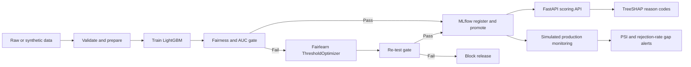

# FairGate — Fairness-Gated MLOps for Credit Default Prediction

[](#) [](#) [](#) [](#)

**FairGate** is an end-to-end MLOps demonstration for credit-default prediction. A candidate model must pass both predictive-performance and group-fairness checks before it can be registered and promoted. The project also demonstrates post-processing mitigation, explainable predictions, model tracking, and simulated data/fairness-drift monitoring.

> **Educational prototype only.** The default workflow generates synthetic data with a Home Credit-like schema. It is not a lending product and must not be used to approve or reject real applicants.

## Pipeline



## Key capabilities

- Synthetic sample-data generator; optional Home Credit competition data input.
- Data validation, feature engineering, and stratified train/test split.
- LightGBM classifier with a configurable risk-based rejection threshold.
- Fairness gate using ROC-AUC, demographic-parity gap, and equal-opportunity gap.
- Fairlearn `ThresholdOptimizer` post-processing when the initial candidate fails.
- MLflow experiment tracking and model registry; only gate-passed bundles are promoted.
- FastAPI endpoints for health, model metadata, scoring, gate reports, monitoring chart, and HTML report.
- TreeSHAP-based top-three reason codes.
- Simulated production monitoring using Population Stability Index (PSI) and group rejection-rate gaps.
- Unit/API tests.

## Technology stack

| Area | Tools |
|---|---|
| Model | LightGBM, scikit-learn |
| Fairness | Fairlearn |
| Experiment tracking / registry | MLflow |
| Explainability | SHAP / TreeSHAP |
| API | FastAPI, Uvicorn |
| Demo UI | Gradio notebook demo |
| Data and configuration | pandas, NumPy, PyYAML, PyArrow |
| Tests | pytest |

## Repository layout

```text
.
├── app/
│   ├── __init__.py
│   ├── index.html
│   └── main.py
├── docs/
│   ├── architecture.md
│   ├── results-and-limitations.md
│   └── viva-guide.md
├── notebooks/
│   └── FairGate_MLOps.ipynb
├── src/
│   ├── common.py
│   ├── gate.py
│   ├── make_sample_data.py
│   ├── mitigate.py
│   ├── monitor.py
│   ├── predictor.py
│   ├── prepare.py
│   ├── register.py
│   └── train.py
├── tests/
│   └── test_fairgate.py
├── params.yaml
├── requirements.txt
└── run_pipeline.py
```

## Run locally

Python 3.10 or newer is recommended.

```bash
git clone https://github.com/RaghavBhatambarekar/fairgate-mlops.git
cd fairgate-mlops

python -m venv .venv
# macOS / Linux:
source .venv/bin/activate
# Windows PowerShell:
# .venv\Scripts\Activate.ps1

pip install -r requirements.txt

# Generate the default synthetic sample
python src/make_sample_data.py

# Run prepare → train → gate → optional mitigation → register → monitor
python run_pipeline.py
```

The pipeline writes local artifacts under `data/`, `models/`, `reports/`, and MLflow tracking files. These generated artifacts and datasets are excluded from Git.

### Run the API

After a successful pipeline run:

```bash
uvicorn app.main:app --reload
```

Open [http://127.0.0.1:8000/docs](http://127.0.0.1:8000/docs) for interactive API documentation. The API expects a trained, gate-approved model at `models/production.joblib`.

### Run tests

```bash
pytest -q
```

The API prediction test requires the pipeline to have produced the production model artifact.

## Configure the gate

Edit `params.yaml`:

| Check | Config key | Default threshold |
|---|---|---:|
| ROC-AUC | `gate.min_auc` | `0.70` minimum |
| Demographic parity gap | `gate.max_dp_diff` | `0.05` maximum |
| Equal opportunity gap | `gate.max_eo_diff` | `0.10` maximum |
| PSI drift alert | `monitor.psi_limit` | `0.20` |
| Rejection-rate gap alert | `monitor.fair_limit` | `0.08` |

The project defines prediction value `1` as **REJECT**. Demographic parity is measured here as the gap in rejection/selection rates, and equal opportunity as the gap in true-positive rates for the default class. Check label and decision semantics before changing the implementation.

## Data options

- **Default:** generated synthetic sample. It is useful for a reproducible demo but does not represent real Home Credit performance.
- **Optional:** Home Credit Default Risk competition data. The notebook documents the Kaggle workflow. You must accept the competition rules and supply your own Kaggle API credentials. Never commit `kaggle.json`, credentials, or applicant-level data.

## Results and limitations

The project presentation reports a synthetic-data demonstration in which the original candidate fails configured fairness checks and the mitigated decision rule passes while ROC-AUC remains reported as 0.708. See [reported results and limitations](docs/results-and-limitations.md) for the figures and caveats.

The mitigation uses group-specific decision rules and requires sensitive-group information at decision time. The monitoring scenario is simulated. Passing these selected metrics does not prove universal fairness, legal compliance, calibration, or suitability for lending.

## Documentation

- [Architecture and workflow](docs/architecture.md)
- [Reported results and limitations](docs/results-and-limitations.md)
- [Viva / code walkthrough guide](docs/viva-guide.md)
- [Contributing and reproducibility notes](CONTRIBUTING.md)

## Author

**Raghav Bhatambarekar** · Group 16 · MLOps course project  
Symbiosis Institute of Technology, Pune
