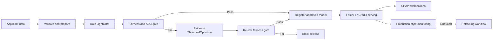

# FairGate — Fairness-Gated MLOps for Credit Default Prediction

   

**FairGate** is an academic MLOps project exploring how fairness checks can become a release requirement for a credit-default prediction system. It combines model training and tracking with fairness evaluation, post-processing mitigation, explainable predictions, serving, and drift monitoring.

> **Important scope note:** The results presented here are from a **synthetic dataset following the Home Credit schema**, not from the full real-world Home Credit dataset. This is a prototype for learning and demonstration, not a production lending system or a credit decision recommendation.

## Why FairGate?

A credit-risk model can have useful predictive performance while producing materially different outcomes across demographic groups. FairGate demonstrates a workflow in which a candidate model is evaluated against both predictive-performance and group-fairness criteria before it is promoted.

## Pipeline at a glance

## Technology stack

| Area | Technology | Purpose |
|---|---|---|
| Tabular model | LightGBM | Credit-default classification |
| Fairness | Fairlearn | Group metrics and ThresholdOptimizer mitigation |
| Experiment tracking / registry | MLflow | Track runs, metrics, artifacts and model versions |
| Explainability | TreeSHAP | Return the strongest feature contributions |
| API | FastAPI | Serve predictions over HTTP |
| Demo UI | Gradio | Interactive applicant-scoring interface |
| Data / metrics | PSI and rejection-rate gaps | Monitor distribution and fairness changes |
| Packaging / workflow | Docker, GitHub Actions, DVC | Containerization, CI and data/version workflow |

## Fairness gate

The project presentation describes these release criteria:

| Check | Metric | Threshold |
|---|---|---:|
| Predictive performance | ROC-AUC on held-out test data | ≥ 0.70 |
| Demographic parity | Largest group rejection-rate gap | ≤ 0.05 |
| Equal opportunity | Largest group true-positive-rate gap | ≤ 0.10 |

A candidate that fails is not promoted directly. The workflow attempts post-processing mitigation with Fairlearn's `ThresholdOptimizer`, then evaluates the resulting decision rule again.

**Interpretation caution:** Fairness metrics represent different definitions of fairness and can conflict. Passing these configured checks does not establish that a system is universally fair, legally compliant, or appropriate for real lending decisions.

## Reported demonstration results

The accompanying project presentation reports the following synthetic-data results:

| Metric | Original candidate | Mitigated model |
|---|---:|---:|
| Gate outcome | Blocked | Passed |
| Demographic parity gap | 0.249 | 0.040 |
| Equal opportunity gap | 0.414 | 0.022 |
| ROC-AUC | 0.708 | 0.708 |
| Under-30 rejection rate | 29.3% | 14.4% |
| Over-50 rejection rate | 4.5% | 18.4% |
| Overall rejection rate | 14.3% | 17.2% |

These are the values reported in the presentation; they are not independently reproduced or validated in this repository yet. See [the results notes](docs/results-and-limitations.md).

## Monitoring concept

The presentation specifies two production-style signals:

- **Fairness drift:** a group rejection-rate gap above **0.08**.
- **Data drift:** a maximum Population Stability Index (PSI) above **0.20**.

The demonstration describes fairness drift being detected at batch 3 (gap 0.097 while PSI is 0.04), before a data-drift-only threshold would react at batch 6 (PSI 0.306). These are simulated batches, not live banking traffic.

## Repository contents

- [Architecture and workflow](docs/architecture.md)
- [Results, assumptions and limitations](docs/results-and-limitations.md)
- [Viva / code walkthrough guide](docs/viva-guide.md)

> **Source-code status:** The project presentation PDF was available when this repository documentation was prepared, but the original Jupyter notebook and Python source files were not available as repository inputs. The repository therefore documents the presented design and reported results without inventing or replacing the original implementation. Add the original notebook/source files before treating this repository as a reproducible code release.

## Getting started

At this stage, this repository is a documentation-first project record. A verified installation command cannot be provided until the original source tree and dependency file are added.

When adding the implementation, include at minimum:
1. The original notebook or source modules.
2. A pinned dependency file (for example, `requirements.txt`).
3. Configuration files and safe sample data instructions.
4. Tests and the exact command used to run them.
5. A clear separation between synthetic demonstration data and any licensed/downloaded dataset.

## Responsible-use note

This project is educational. It must not be used to approve or reject real applicants. Group-aware post-processing may require sensitive group information at decision time, which can be restricted by policy or law. Any real-world use would require domain, legal, privacy, security, model-risk, and human-governance review.

## Author

**Raghav Bhatambarekar**  
MLOps course project — Group 16  
Symbiosis Institute of Technology, Pune

